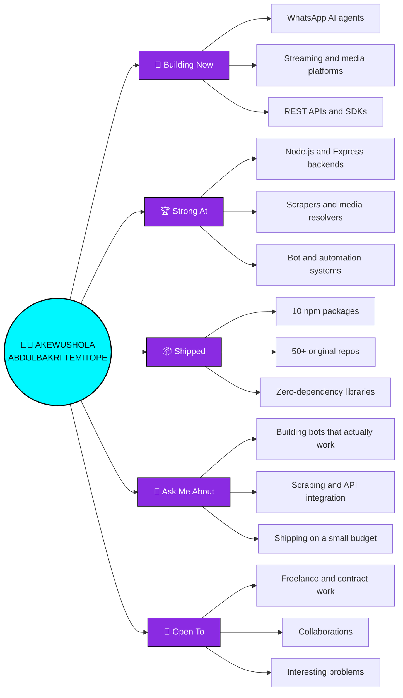

<!-- ============================================================ -->
<!--                    BROKENVZN  ·  PROFILE README              -->
<!--         Akewushola Abdulbakri Temitope  ·  Neaterry6         -->
<!-- ============================================================ -->

<div align="center">


<br>


<br>

<a href="https://neaterry6.github.io"></a>


</div>

---

<div align="center">

> ### "I don't just write code — I build things people actually use."

**50+ original repositories** · **10 published npm packages** · **AI agents** · **REST APIs** · **WhatsApp bots**

</div>

---

## 🗺️ At a glance



---

# 🚀 What I'm Building Right Now

<table>
<tr>
<td width="50%" valign="top">

### 🤖 Broken — WhatsApp AI Agent
A full execution agent that lives in WhatsApp. Not a chatbot — it runs shell commands, browses the web, generates media, hosts sites, and ships code on request.

`Node.js` `Baileys` `LLM tool-calling` `Docker`

</td>
<td width="50%" valign="top">

### 🎬 BROKEN Movies
Streaming platform with its own scraper backend — TMDB metadata, multi-source embed resolution, IPTV, and an HLS player.

`Express` `Node.js` `TMDB API` `HLS`

</td>
</tr>
<tr>
<td width="50%" valign="top">

### 🧠 Brokenvzn AI
Multi-capability AI platform — assistant, chat, and generation tools behind one interface.

`JavaScript` `Vercel`

</td>
<td width="50%" valign="top">

### 🎧 BrokenVZN Music API
A stack of music/lyrics endpoints — search, stream, and lyrics resolution, built to be dropped into any bot or app.

`Node.js` `Python` `REST`

</td>
</tr>
</table>

---

# 🌐 Live Projects

> Every link below was checked and is **live right now**. If it is listed here, it loads.

<table>
<tr>
<td width="50%" valign="top">

**🎬 Streaming & Media**

- [**Manga We**](https://manga-we.vercel.app) — manga reader with a clean UI
- [**StreamMe Chatroom**](https://streamme-chatroom-id.vercel.app) — live chatroom app

</td>
<td width="50%" valign="top">

**🤖 AI & Tools**

- [**Brokenvzn AI**](https://brokenvzn-ai.vercel.app) — multi-capability AI platform
- [**Story Writer AI**](https://my-story-writer-ai.vercel.app) — AI story generation
- [**Jespire Stories**](https://jespire-stories.vercel.app) — story publishing platform
- [**Pinterest API**](https://pinterest-api-phi.vercel.app) — image search API

</td>
</tr>
<tr>
<td width="50%" valign="top">

**📚 Web & Education**

- [**Phoenix Learn Code**](https://phoenix-learn-code.vercel.app) — interactive coding lessons
- [**Glamour**](https://glamour-net.vercel.app) — beauty & fashion platform
- [**Portfolio**](https://neaterry6.github.io) — my own site

</td>
<td width="50%" valign="top">

**🔌 APIs & Backends**

- [**Lyrics API**](https://github.com/Neaterry6/Lyrics-s) — song lyrics lookup
- [**YT API**](https://github.com/Neaterry6/Yt-api) — YouTube metadata
- [**Translator API**](https://github.com/Neaterry6/translator-api) — translation endpoints
- [**Roast API**](https://github.com/Neaterry6/roast-api) — roast generator

<sub>Backends are source-available; hosted endpoints listed under [Packages](#-packages).</sub>

</td>
</tr>
</table>

---

# 🚧 In Progress

Honest list — these are built but their deployments are down or mid-rebuild. Working through them:

- 🎬 **BROKEN Movies** — streaming platform + scraper backend (redeploying)
- 📸 **Hi Photos** — photo sharing app (redeploying)
- 📝 **UTME Prep** — exam practice app (rebuilding)
- 🎵 **YT Play / Video Downloader APIs** — media resolvers (rebuilding)

<sub>No dead links above on purpose — I'd rather show 9 things that work than 21 that don't.</sub>

---

# 📦 Packages

**Ten published npm packages.** Most are zero-dependency — no axios, no SDKs, nothing to keep updated. Full TypeScript types, dual ESM + CJS builds, and every one has a test suite.

<div align="center">

### 🌸 Anime & Manga

| Package | What it does | Install |
|---|---|---|
| [**broken-anime-api**](https://www.npmjs.com/package/broken-anime-api) | Real anime data — search, characters, trending, recommendations via **AniList + Kitsu** | `npm i broken-anime-api` |
| [**broken-anime**](https://www.npmjs.com/package/broken-anime) | Anime images and 59 reaction GIFs, no API key | `npm i broken-anime` |
| [**broken-anime-card**](https://www.npmjs.com/package/broken-anime-card) | Render character trading cards as SVG | `npm i broken-anime-card` |
| [**broken-anime-card-api**](https://www.npmjs.com/package/broken-anime-card-api) | Self-hosted card REST API — real AniList data as SVG, no headless browser | `npm i broken-anime-card-api` |
| [**broken-manga**](https://www.npmjs.com/package/broken-manga) | Manga search, chapters and page images via MangaDex | `npm i broken-manga` |
| [**broken-hentai**](https://www.npmjs.com/package/broken-hentai) | Adult image search across 4 booru providers 🔞 | `npm i broken-hentai` |

### 🎵 Media & Music

| Package | What it does | Install |
|---|---|---|
| [**broken-lyrics**](https://www.npmjs.com/package/broken-lyrics) | Lyrics lookup + synced LRC parsing | `npm i broken-lyrics` |
| [**broken-translate**](https://www.npmjs.com/package/broken-translate) | Translation with auto-detect, batch and long-text support | `npm i broken-translate` |

### 🛠 Utilities

| Package | What it does | Install |
|---|---|---|
| [**broken-roasts**](https://www.npmjs.com/package/broken-roasts) | Roast generator — 5 flavours, works offline | `npm i broken-roasts` |
| [**broken-wa-api**](https://www.npmjs.com/package/broken-wa-api) | WhatsApp API + SDK on Baileys — multi-session, buttons, webhooks | `npm i broken-wa-api` |

</div>

```js
const { search } = require('broken-anime-api');
const { results } = await search('naruto');
results[0].title;   // 'Naruto'

const { search: findManga } = require('broken-manga');
await findManga('berserk');   // real chapters + page images

const { getRoast } = require('broken-roasts');
getRoast('savage');   // "You have the perfect face for radio."
```

<sub>Nine of the ten have <b>zero dependencies</b>. Every package is tested against its real upstream API, not mocks.</sub>

### 🧩 More APIs (source available)

| Module | What it does | Stack |
|---|---|---|
| [**Lyrics API**](https://github.com/Neaterry6/Lyrics-s) | Song lyrics lookup + search | Python |
| [**LrcApi**](https://github.com/Neaterry6/LrcApi) | Timed `.lrc` lyric streaming | Flask |
| [**Spotify Lyrics API**](https://github.com/Neaterry6/Spotify-lyrics-api) | Lyrics matched to Spotify tracks | Python |
| [**YT API**](https://github.com/Neaterry6/Yt-api) | YouTube search + metadata | JavaScript |
| [**YTDL API**](https://github.com/Neaterry6/ytdl-API-) | Video/audio extraction | JavaScript |
| [**Music API**](https://github.com/Neaterry6/Music-Api-) | Music search + streaming | JavaScript |
| [**Pexels / Pinterest API**](https://github.com/Neaterry6/pexel-api) | Image search + proxy | HTML |
| [**Blocklist Manager**](https://github.com/Neaterry6/blocklist-manager) | Phone blocklist with import/export | Node.js |

<sub>Want one of these as a package? [Open an issue](https://github.com/Neaterry6/Neaterry6/issues).</sub>

---

# 🌸 Anime & Manga

Anime and manga are a running theme in what I build.

<table>
<tr>
<td width="50%" valign="top">

**Live now**

- [**Manga We**](https://manga-we.vercel.app) — manga reader, clean UI
- [**StreamMe Chatroom**](https://streamme-chatroom-id.vercel.app) — watch-along chat

</td>
<td width="50%" valign="top">

**Source**

- [**streamMe-anime**](https://github.com/Neaterry6/streamMe-anime) — anime streaming app
- [**manga-web**](https://github.com/Neaterry6/manga-web) — manga reader
- [**STREAM.ME.ID**](https://github.com/Neaterry6/STREAM.ME.ID) — streaming frontend
- [**fzseries-api**](https://github.com/Neaterry6/fzseries-api) — Python SDK for fztvseries.live
- [**Movieboxpi**](https://github.com/Neaterry6/Movieboxpi) — MovieBox protocol & architecture notes

</td>
</tr>
</table>

---

# 🎮 Games

<table>
<tr>
<td width="50%" valign="top">

### ▶ [NEON BREAKOUT](https://neaterry6.github.io/neon-breakout/)

A neon arcade breakout game. **One HTML file, zero dependencies, works offline.**

Endless levels, paddle-angle control, tougher bricks as you climb, particles and screen shake, and a best score saved locally.

Built and tested headlessly — 31 checks driving real game frames.

**[Play it →](https://neaterry6.github.io/neon-breakout/)** · [Source](https://github.com/Neaterry6/neon-breakout)

</td>
<td width="50%" valign="top">

### 🤖 Games inside the bot

The WhatsApp agent ships games, music, lyrics and social features — playable straight from chat.

[**Broken-agent**](https://github.com/Neaterry6/Broken-agent) — a WhatsApp agent rebuilt from scratch on Agnes AI

More arcade games are in progress.

</td>
</tr>
</table>

---

# 🛠 Tech Stack

<div align="center">

**Languages**


**Frontend**


**Backend & APIs**


**Databases**


**Tools & Deploy**


</div>

---

# 👤 About Me

```javascript
const brokenvzn = {
    name: "Akewushola Abdulbakri Temitope",
    alias: "brokenvzn",

    location: "Nigeria 🇳🇬",
    education: "Westland University, Iwo, Osun State",

    role: "Full Stack Developer & AI Engineer",

    whatIBuild: [
        "AI agents & automation",
        "REST APIs people can actually plug into",
        "Streaming & media platforms",
        "WhatsApp bots",
        "Web apps with clean UI"
    ],

    languages: ["JavaScript", "TypeScript", "Python", "HTML", "CSS"],
    frontend:  ["React", "Next.js", "Tailwind CSS", "Bootstrap"],
    backend:   ["Node.js", "Express", "Flask", "REST APIs"],
    databases: ["MongoDB", "Firebase", "Supabase", "SQLite"],
    tools:     ["Git", "VS Code", "Railway", "Vercel", "Docker", "Linux"],

    alsoInto: ["Writing", "Singing", "Music"],

    philosophy: "Ship it, then make it better."
}
```

---

# 📊 GitHub Stats

<div align="center">


<br>


</div>

---

# 📈 Activity

<div align="center">

<a href="https://github.com/ashutosh00710/github-readme-activity-graph">

</a>

<br/><br/>

<picture>
  <source media="(prefers-color-scheme: dark)" srcset="https://raw.githubusercontent.com/Neaterry6/Neaterry6/output/github-contribution-grid-snake-dark.svg" />
  <source media="(prefers-color-scheme: light)" srcset="https://raw.githubusercontent.com/Neaterry6/Neaterry6/output/github-contribution-grid-snake.svg" />
  
</picture>

</div>

---

# 📬 Connect

<div align="center">

<a href="mailto:akewusholaabdulbakri101@gmail.com"></a>
<a href="https://t.me/Broken_vzn11"></a>
<a href="https://www.instagram.com/broken_vzn/"></a>
<a href="https://www.tiktok.com/@bnlsquad_boybroken"></a>
<a href="https://www.facebook.com/profile.php?id=61587403051704"></a>

**Open to work** — freelance, collabs, and interesting problems.
Best way to reach me: [email](mailto:akewusholaabdulbakri101@gmail.com) or [Telegram](https://t.me/Broken_vzn11).

</div>

---

<div align="center">

### ⭐ If any of my work helped you, a star means a lot.


</div>
