<!-- ============================================================ -->
<!--                    BROKENVZN  ·  PROFILE README              -->
<!--         Akewushola Abdulbakri Temitope  ·  Neaterry6         -->
<!-- ============================================================ -->

<div align="center">


<br>


<br>

<a href="https://neaterry6.github.io"></a>


</div>

<div align="center">
  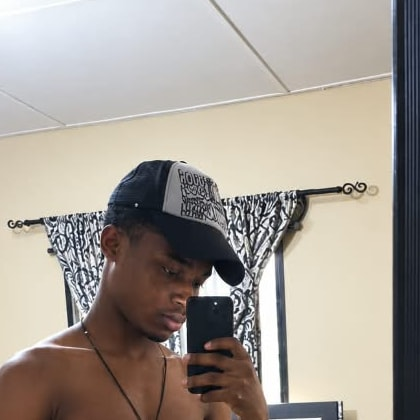
</div>

---

<div align="center">

> ### "I don't just write code — I build things people actually use."

**50+ original repositories** · **10 published npm packages** · **AI agents** · **REST APIs** · **WhatsApp bots**

</div>

---

## 🗺️ At a glance

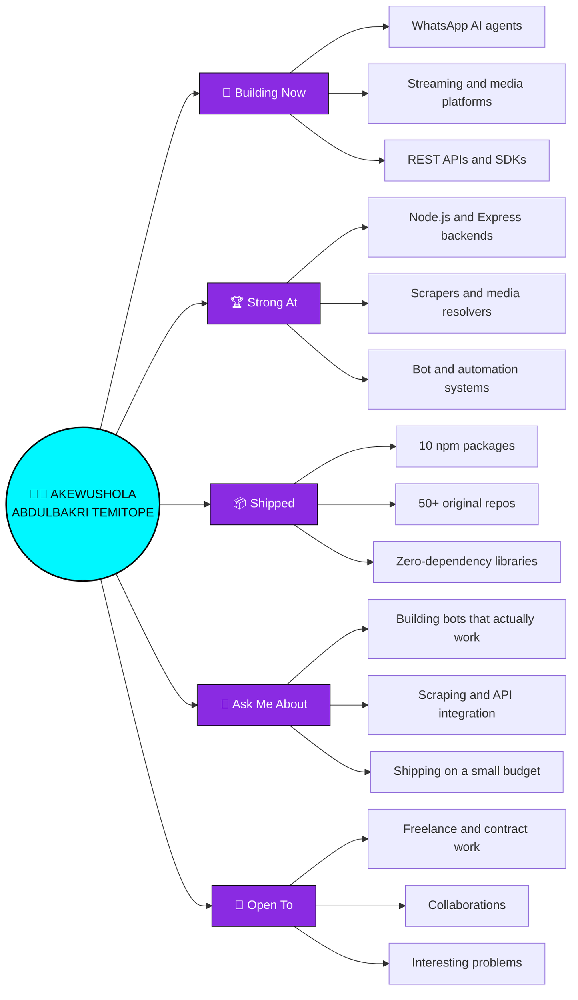

---

# 🚀 What I'm Building Right Now

<table>
<tr>
<td width="50%" valign="top">

### 🤖 Broken — WhatsApp AI Agent
A full execution agent that lives in WhatsApp. Not a chatbot — it runs shell commands, browses the web, generates media, hosts sites, and ships code on request.

`Node.js` `Baileys` `LLM tool-calling` `Docker`

</td>
<td width="50%" valign="top">

### 🎬 BROKEN Movies
Streaming platform with its own scraper backend — TMDB metadata, multi-source embed resolution, IPTV, and an HLS player.

`Express` `Node.js` `TMDB API` `HLS`

</td>
</tr>
<tr>
<td width="50%" valign="top">

### 🧠 Brokenvzn AI
Multi-capability AI platform — assistant, chat, and generation tools behind one interface.

`JavaScript` `Vercel`

</td>
<td width="50%" valign="top">

### 🎧 BrokenVZN Music API
A stack of music/lyrics endpoints — search, stream, and lyrics resolution, built to be dropped into any bot or app.

`Node.js` `Python` `REST`

</td>
</tr>
</table>

---

# 🌐 Live Projects

Every site below was opened and screenshotted — if it is listed here, it loads right now.

|  |  |
|---|---|
| <a href="https://manga-we.vercel.app">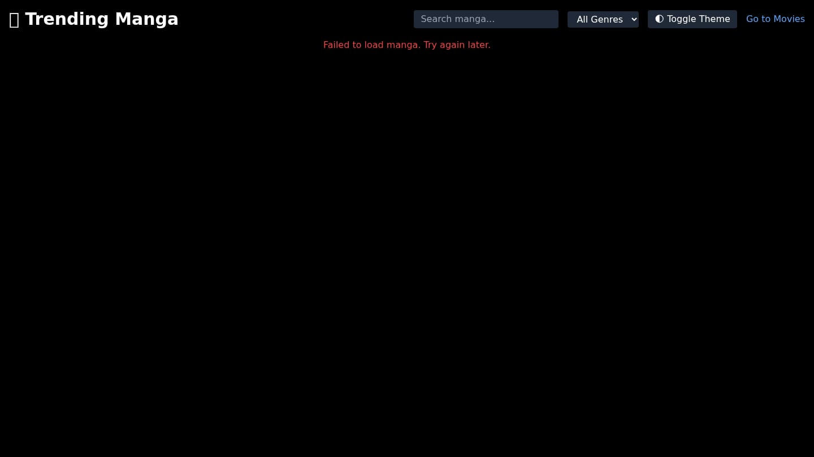</a><br/><sub><b>Manga We</b></sub> — <sub>manga reader, clean UI</sub> | <a href="https://streamme-chatroom-id.vercel.app">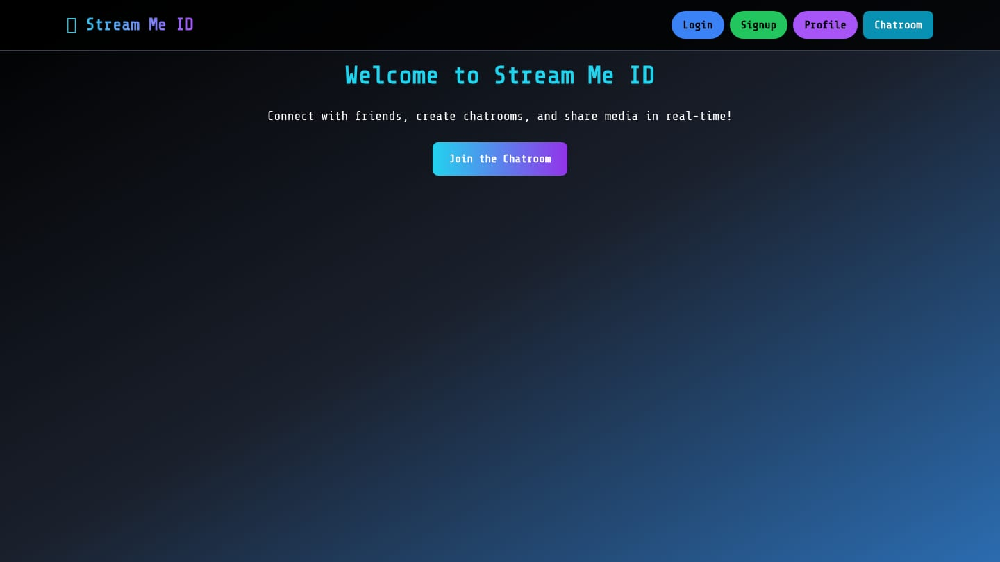</a><br/><sub><b>StreamMe Chatroom</b></sub> — <sub>live chatroom</sub> |
| <a href="https://brokenvzn-ai.vercel.app">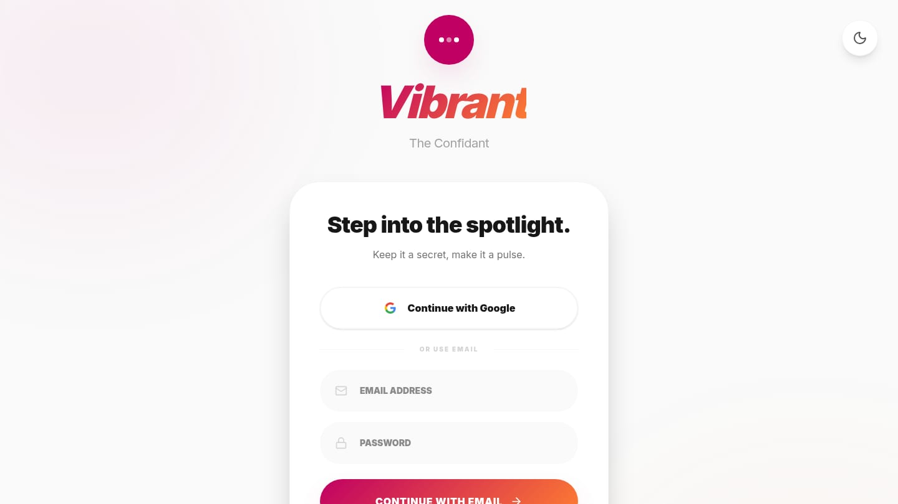</a><br/><sub><b>Brokenvzn AI</b></sub> — <sub>multi-capability AI platform</sub> | <a href="https://my-story-writer-ai.vercel.app">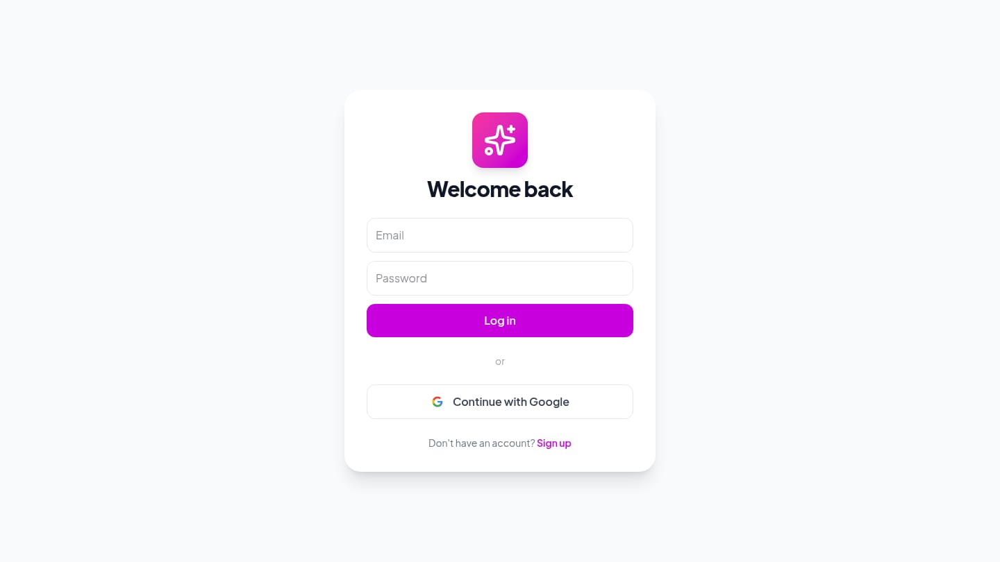</a><br/><sub><b>Story Writer AI</b></sub> — <sub>AI story generation</sub> |
| <a href="https://jespire-stories.vercel.app">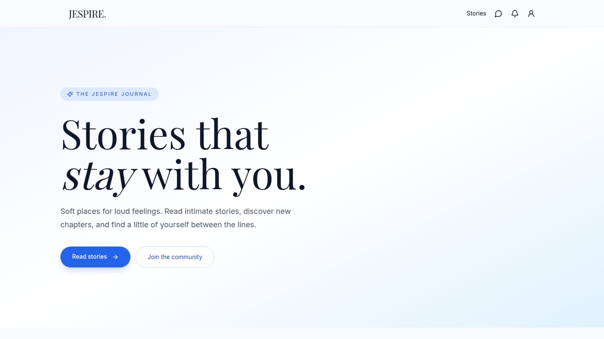</a><br/><sub><b>Jespire Stories</b></sub> — <sub>story publishing platform</sub> | <a href="https://pinterest-api-phi.vercel.app">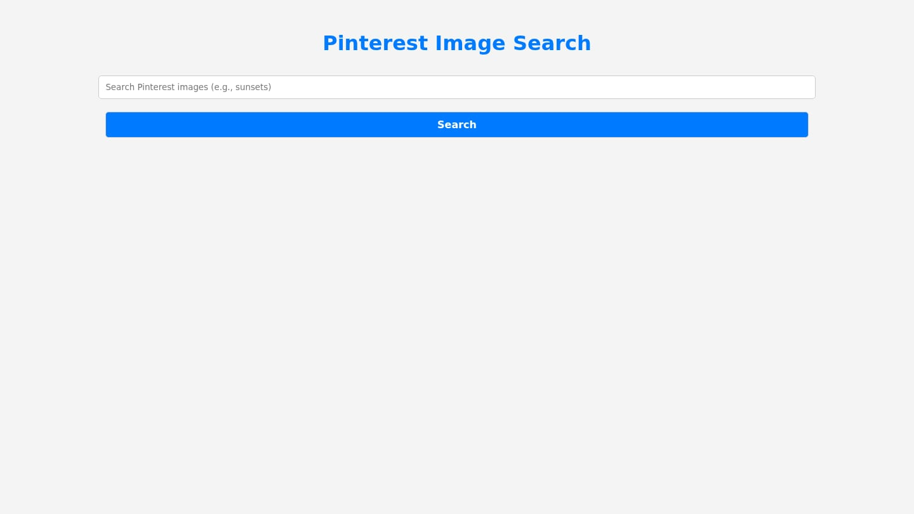</a><br/><sub><b>Pinterest API</b></sub> — <sub>image search API</sub> |
| <a href="https://phoenix-learn-code.vercel.app">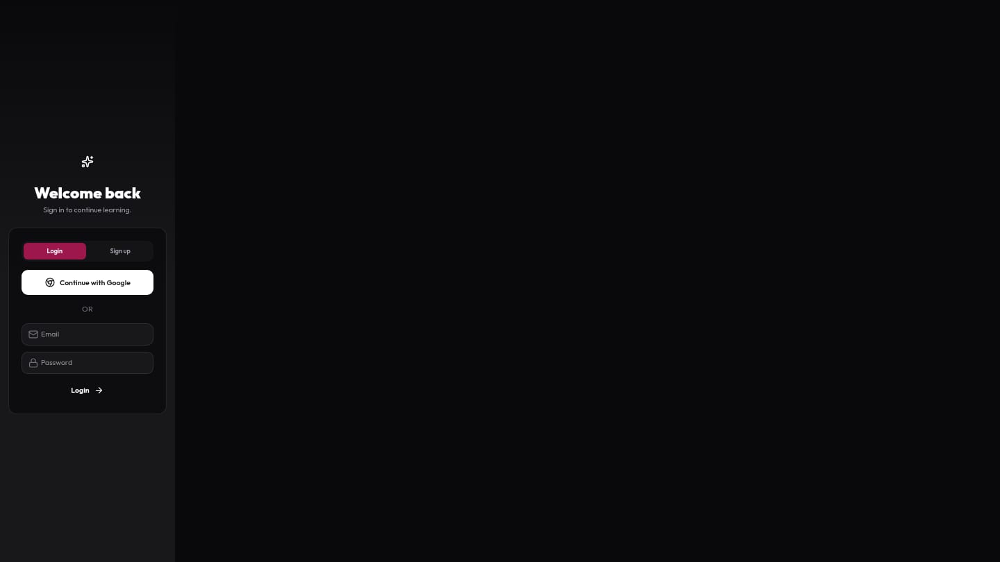</a><br/><sub><b>Phoenix Learn Code</b></sub> — <sub>interactive coding lessons</sub> | <a href="https://glamour-net.vercel.app">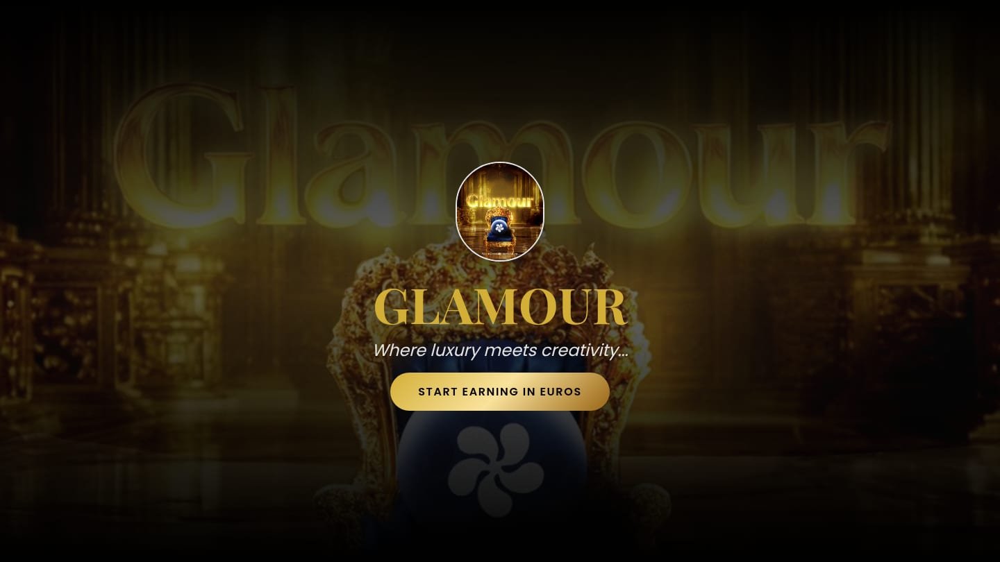</a><br/><sub><b>Glamour</b></sub> — <sub>beauty and fashion platform</sub> |
| <a href="https://neaterry6.github.io">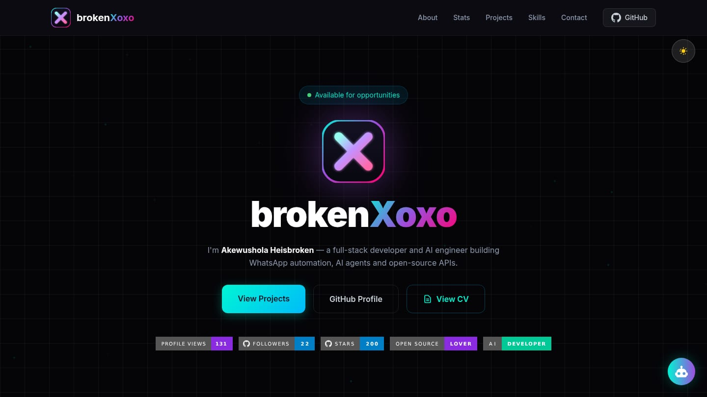</a><br/><sub><b>Portfolio</b></sub> — <sub>my own site</sub> |  |

### 🔌 APIs & backends

Source-available. Hosted endpoints are listed under [Packages](#-packages).

| API | What it does |
|---|---|
| [**Lyrics API**](https://github.com/Neaterry6/Lyrics-s) | Song lyrics lookup and search |
| [**YT API**](https://github.com/Neaterry6/Yt-api) | YouTube search and metadata |
| [**Translator API**](https://github.com/Neaterry6/translator-api) | Translation endpoints |
| [**Roast API**](https://github.com/Neaterry6/roast-api) | Roast generator |

---

# 🚧 In Progress

Honest list — these are built but their deployments are down or mid-rebuild. Working through them:

- 🎬 **BROKEN Movies** — streaming platform + scraper backend (redeploying)
- 📸 **Hi Photos** — photo sharing app (redeploying)
- 📝 **UTME Prep** — exam practice app (rebuilding)
- 🎵 **YT Play / Video Downloader APIs** — media resolvers (rebuilding)

<sub>No dead links above on purpose — I'd rather show 9 things that work than 21 that don't.</sub>

---

# 📦 Packages

**Ten published npm packages.** Most are zero-dependency — no axios, no SDKs, nothing to keep updated. Full TypeScript types, dual ESM + CJS builds, and every one has a test suite.

### 🌸 Anime & manga packages

| Package | What it does |
|---|---|
| [**broken-anime-api**](https://www.npmjs.com/package/broken-anime-api) | Anime data via AniList + Kitsu — search, characters, trending |
| [**broken-anime**](https://www.npmjs.com/package/broken-anime) | Anime images and 59 reaction GIFs, no API key |
| [**broken-anime-card**](https://www.npmjs.com/package/broken-anime-card) | Character trading cards rendered as SVG |
| [**broken-anime-card-api**](https://www.npmjs.com/package/broken-anime-card-api) | Self-hosted card API — AniList data as SVG, no browser |
| [**broken-manga**](https://www.npmjs.com/package/broken-manga) | Manga search, chapters and pages via MangaDex |
| [**broken-hentai**](https://www.npmjs.com/package/broken-hentai) | Adult image search across 4 booru providers 🔞 |

```bash
npm i broken-anime-api broken-anime broken-anime-card broken-anime-card-api broken-manga broken-hentai
```

### 🎵 Media & music packages

| Package | What it does |
|---|---|
| [**broken-lyrics**](https://www.npmjs.com/package/broken-lyrics) | Lyrics lookup with synced LRC parsing |
| [**broken-translate**](https://www.npmjs.com/package/broken-translate) | Translation with auto-detect and batch support |

```bash
npm i broken-lyrics broken-translate
```

### 🛠 Utility packages

| Package | What it does |
|---|---|
| [**broken-roasts**](https://www.npmjs.com/package/broken-roasts) | Roast generator — 5 flavours, works offline |
| [**broken-wa-api**](https://www.npmjs.com/package/broken-wa-api) | WhatsApp API + SDK on Baileys — multi-session, webhooks |

```bash
npm i broken-roasts broken-wa-api
```

```js
const { search } = require('broken-anime-api');
const { results } = await search('naruto');
results[0].title;   // 'Naruto'

const { search: findManga } = require('broken-manga');
await findManga('berserk');   // real chapters + page images

const { getRoast } = require('broken-roasts');
getRoast('savage');   // "You have the perfect face for radio."
```

<sub>Nine of the ten have <b>zero dependencies</b>. Every package is tested against its real upstream API, not mocks.</sub>

### 🧩 More APIs (source available)

| Module | What it does | Built with |
|---|---|---|
| [**Lyrics API**](https://github.com/Neaterry6/Lyrics-s) | Song lyrics lookup and search | Python |
| [**LrcApi**](https://github.com/Neaterry6/LrcApi) | Timed `.lrc` lyric streaming | Python |
| [**Spotify Lyrics API**](https://github.com/Neaterry6/Spotify-lyrics-api) | Lyrics matched to Spotify tracks | Python |
| [**YT API**](https://github.com/Neaterry6/Yt-api) | YouTube search and metadata | JavaScript |
| [**YTDL API**](https://github.com/Neaterry6/ytdl-API-) | Video and audio extraction | JavaScript |
| [**Music API**](https://github.com/Neaterry6/Music-Api-) | Music search and streaming | JavaScript |
| [**Pexels API**](https://github.com/Neaterry6/pexel-api) | Image search and proxy | HTML / CSS |
| [**Blocklist Manager**](https://github.com/Neaterry6/blocklist-manager) | Phone blocklist with import and export | JavaScript |

<sub>Want one of these as a package? [Open an issue](https://github.com/Neaterry6/Neaterry6/issues).</sub>

---

# 🌸 Anime & Manga

Anime and manga are a running theme in what I build — and these are the ones I actually watch.

|  |  |  |  |
|---|---|---|---|
| <a href="https://anilist.co/anime/16498"></a><br/><sub><b>Attack on Titan</b></sub><br/><sub>⭐ 85 · TV</sub> | <a href="https://anilist.co/anime/101922"></a><br/><sub><b>Demon Slayer: Kimetsu no…</b></sub><br/><sub>⭐ 82 · TV</sub> | <a href="https://anilist.co/anime/113415"></a><br/><sub><b>JUJUTSU KAISEN</b></sub><br/><sub>⭐ 84 · TV</sub> | <a href="https://anilist.co/anime/1535"></a><br/><sub><b>Death Note</b></sub><br/><sub>⭐ 84 · TV</sub> |
| <a href="https://anilist.co/anime/21459"></a><br/><sub><b>My Hero Academia</b></sub><br/><sub>⭐ 77 · TV</sub> | <a href="https://anilist.co/anime/11061"></a><br/><sub><b>Hunter x Hunter (2011)</b></sub><br/><sub>⭐ 89 · TV</sub> | <a href="https://anilist.co/anime/21087"></a><br/><sub><b>One-Punch Man</b></sub><br/><sub>⭐ 82 · TV</sub> | <a href="https://anilist.co/anime/21"></a><br/><sub><b>ONE PIECE</b></sub><br/><sub>⭐ 87 · TV</sub> |
| <a href="https://anilist.co/anime/20605"></a><br/><sub><b>Tokyo Ghoul</b></sub><br/><sub>⭐ 76 · TV</sub> | <a href="https://anilist.co/anime/5114"></a><br/><sub><b>Fullmetal Alchemist: Bro…</b></sub><br/><sub>⭐ 90 · TV</sub> | <a href="https://anilist.co/anime/20"></a><br/><sub><b>Naruto</b></sub><br/><sub>⭐ 80 · TV</sub> | <a href="https://anilist.co/anime/11757"></a><br/><sub><b>Sword Art Online</b></sub><br/><sub>⭐ 70 · TV</sub> |
| <a href="https://anilist.co/anime/20954"></a><br/><sub><b>A Silent Voice</b></sub><br/><sub>⭐ 88 · MOVIE</sub> | <a href="https://anilist.co/anime/21519"></a><br/><sub><b>Your Name.</b></sub><br/><sub>⭐ 85 · MOVIE</sub> | <a href="https://anilist.co/anime/127230"></a><br/><sub><b>Chainsaw Man</b></sub><br/><sub>⭐ 83 · TV</sub> | <a href="https://anilist.co/anime/101759"></a><br/><sub><b>The Promised Neverland</b></sub><br/><sub>⭐ 83 · TV</sub> |
| <a href="https://anilist.co/anime/20755"></a><br/><sub><b>Assassination Classroom</b></sub><br/><sub>⭐ 79 · TV</sub> | <a href="https://anilist.co/anime/21507"></a><br/><sub><b>Mob Psycho 100</b></sub><br/><sub>⭐ 84 · TV</sub> | <a href="https://anilist.co/anime/21355"></a><br/><sub><b>Re:ZERO -Starting Life i…</b></sub><br/><sub>⭐ 81 · TV</sub> | <a href="https://anilist.co/anime/20665"></a><br/><sub><b>Your lie in April</b></sub><br/><sub>⭐ 84 · TV</sub> |

<sub>Ranked by popularity on [AniList](https://anilist.co). Covers served from AniList's CDN.</sub>

### 🧰 Anime & manga projects

| Project | What it does |
|---|---|
| [**streamMe-anime**](https://github.com/Neaterry6/streamMe-anime) | Anime streaming app |
| [**manga-web**](https://github.com/Neaterry6/manga-web) | Manga reader |
| [**STREAM.ME.ID**](https://github.com/Neaterry6/STREAM.ME.ID) | Streaming frontend |
| [**fzseries-api**](https://github.com/Neaterry6/fzseries-api) | Python SDK for fztvseries.live |
| [**Movieboxpi**](https://github.com/Neaterry6/Movieboxpi) | MovieBox protocol and architecture notes |
| [**Manga We**](https://manga-we.vercel.app) | Manga reader, live |
| [**StreamMe Chatroom**](https://streamme-chatroom-id.vercel.app) | Watch-along chat, live |

---

# 🎮 Games

What I actually play, and what I have built.

## Favourites

**PC & console**

|  |  |  |
|---|---|---|
| <br/><sub><b>Call of Duty: MW II</b></sub> | <br/><sub><b>PUBG: Battlegrounds</b></sub> | <br/><sub><b>GTA V</b></sub> |
| <br/><sub><b>Apex Legends</b></sub> | <br/><sub><b>Counter-Strike 2</b></sub> | <br/><sub><b>Elden Ring</b></sub> |
| <br/><sub><b>Cyberpunk 2077</b></sub> | <br/><sub><b>Red Dead Redemption 2</b></sub> | <br/><sub><b>Rainbow Six Siege</b></sub> |
| <br/><sub><b>Baldur's Gate 3</b></sub> | <br/><sub><b>Rust</b></sub> | <br/><sub><b>Forza Horizon 5</b></sub> |
| <br/><sub><b>Stardew Valley</b></sub> | <br/><sub><b>Terraria</b></sub> | <br/><sub><b>Hollow Knight</b></sub> |
| <br/><sub><b>Rocket League</b></sub> | <br/><sub><b>Valheim</b></sub> | <br/><sub><b>The Witcher 3</b></sub> |
| <br/><sub><b>Skyrim SE</b></sub> | <br/><sub><b>Portal 2</b></sub> |

**Mobile**

|  |  |  |  |  |
|---|---|---|---|---|
| <br/><sub><b>Free Fire</b></sub> | <br/><sub><b>COD Mobile</b></sub> | <br/><sub><b>Minecraft</b></sub> | <br/><sub><b>Clash of Clans</b></sub> | <br/><sub><b>PUBG Mobile</b></sub> |

<sub>Cover art served from Steam's and Google Play's CDNs.</sub>

## What I've built


<table>
<tr>
<td width="50%" valign="top">

### ▶ [NEON BREAKOUT](https://neaterry6.github.io/neon-breakout/)

A neon arcade breakout game. **One HTML file, zero dependencies, works offline.**

Endless levels, paddle-angle control, tougher bricks as you climb, particles and screen shake, and a best score saved locally.

Built and tested headlessly — 31 checks driving real game frames.

**[Play it →](https://neaterry6.github.io/neon-breakout/)** · [Source](https://github.com/Neaterry6/neon-breakout)

</td>
<td width="50%" valign="top">

### 🤖 Games inside the bot

The WhatsApp agent ships games, music, lyrics and social features — playable straight from chat.

[**Broken-agent**](https://github.com/Neaterry6/Broken-agent) — a WhatsApp agent rebuilt from scratch on Agnes AI

More arcade games are in progress.

</td>
</tr>
</table>

---

# 🛠 Tech Stack

<div align="center">

**Languages**


**Frontend**


**Backend & APIs**


**Databases**


**Tools & Deploy**


</div>

---

# 👤 About Me

```javascript
const brokenvzn = {
    name: "Akewushola Abdulbakri Temitope",
    alias: "brokenvzn",

    location: "Nigeria 🇳🇬",
    education: "Westland University, Iwo, Osun State",

    role: "Full Stack Developer & AI Engineer",

    whatIBuild: [
        "AI agents & automation",
        "REST APIs people can actually plug into",
        "Streaming & media platforms",
        "WhatsApp bots",
        "Web apps with clean UI"
    ],

    languages: ["JavaScript", "TypeScript", "Python", "HTML", "CSS"],
    frontend:  ["React", "Next.js", "Tailwind CSS", "Bootstrap"],
    backend:   ["Node.js", "Express", "Flask", "REST APIs"],
    databases: ["MongoDB", "Firebase", "Supabase", "SQLite"],
    tools:     ["Git", "VS Code", "Railway", "Vercel", "Docker", "Linux"],

    alsoInto: ["Writing", "Singing", "Music"],

    philosophy: "Ship it, then make it better."
}
```

---

# 📊 GitHub Stats

<div align="center">


<br>


</div>

---

# 📈 Activity

<div align="center">

<a href="https://github.com/ashutosh00710/github-readme-activity-graph">

</a>

<br/><br/>

<picture>
  <source media="(prefers-color-scheme: dark)" srcset="https://raw.githubusercontent.com/Neaterry6/Neaterry6/output/github-contribution-grid-snake-dark.svg" />
  <source media="(prefers-color-scheme: light)" srcset="https://raw.githubusercontent.com/Neaterry6/Neaterry6/output/github-contribution-grid-snake.svg" />
  
</picture>

</div>

---

# 📬 Connect

<div align="center">

<a href="mailto:akewusholaabdulbakri101@gmail.com"></a>
<a href="https://t.me/Broken_vzn11"></a>
<a href="https://www.instagram.com/broken_vzn/"></a>
<a href="https://www.tiktok.com/@bnlsquad_boybroken"></a>
<a href="https://www.facebook.com/profile.php?id=61587403051704"></a>

**Open to work** — freelance, collabs, and interesting problems.
Best way to reach me: [email](mailto:akewusholaabdulbakri101@gmail.com) or [Telegram](https://t.me/Broken_vzn11).

</div>

---

<div align="center">

### ⭐ If any of my work helped you, a star means a lot.


</div>
